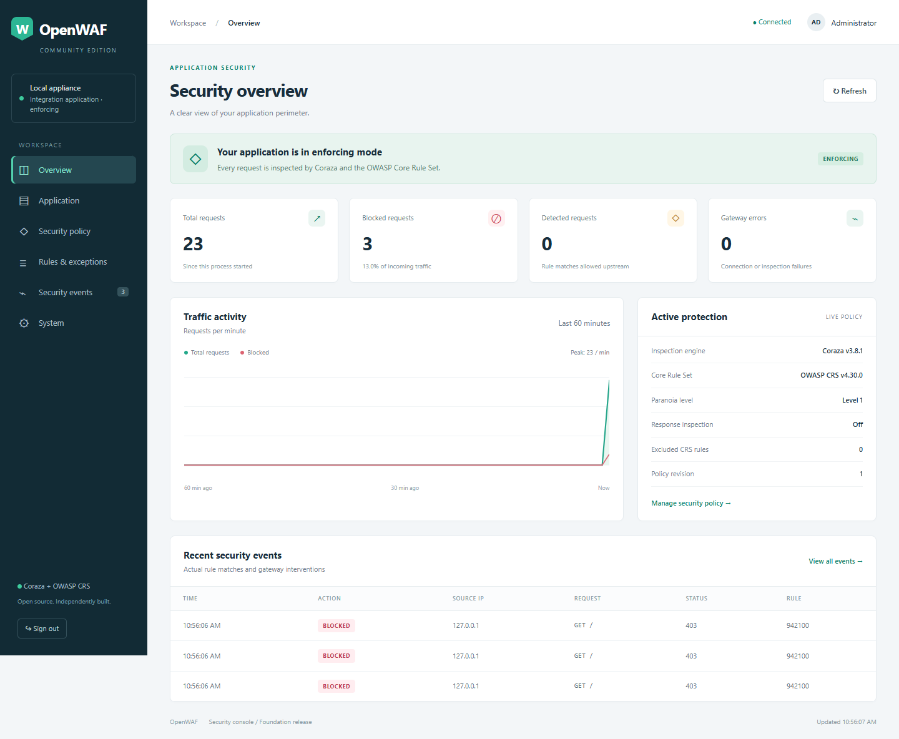

# Jiro

Jiro (formerly OpenWAF) is a self-hosted Go reverse proxy integrating OWASP Coraza and the OWASP Core Rule
Set with an embedded security administration console.

**Development preview.** Application, capacity, operational and independent-review
qualification remains open. The thirty-day pilot has yet to begin.



## Current capabilities

- Hostname-routed applications with separate policies and bounded upstream pools.
- Real CRS inspection for supported HTTP bodies, with manual policy configuration.
- Application/client request rates, body-byte budgets, buffer shares and admission controls.
- Scoped rule exceptions, policy validation, revision history and rollback.
- Local roles, scoped automation tokens, MFA, passkeys and optional OIDC sign-in.
- Durable security events, acknowledged export and administration auditing.
- Linux service packaging, certificate reloads, backups and recovery tooling.

## Build and try locally

The currently qualified toolchain is Go 1.27.3. The module declares Go 1.26 as
its minimum. Building and running the server requires Go.

On Windows, run the launcher from the repository root.

```powershell
./scripts/start.ps1
```

The launcher generates a local administrator token and prints the console URL.
The console defaults to http://127.0.0.1:8081 and the protected listener to
http://127.0.0.1:8080. Start an application at http://127.0.0.1:3000 or configure
its upstream in the console. A new installation creates a local policy file.

On Linux, build the server and configure a fresh administrator token.

```sh
go build -o bin/openwaf ./cmd/waf-server
export OPENWAF_ADMIN_TOKEN="$(openssl rand -hex 32)"
printf 'Local administrator token: %s\n' "$OPENWAF_ADMIN_TOKEN"
./bin/openwaf -config config/policy.json
```

## Evidence and operating boundaries

[Public evidence summary](docs/PUBLIC-EVIDENCE.json) records selected local
qualification results, toolchain/build identity and failed operating profiles.
Its associated [publication notes](PUBLICATION.md) describe provenance and
the private-artifact boundary. These are maintainer-run synthetic lab results.

Windows and Linux full checks include 5,193 CRS cases each. Resource pressure,
latency tails, VM scheduling gaps and same-source contention remain explicit
findings. Select an operating envelope using representative application traffic.

The bundled Coraza source contains a documented downstream ASCII-presence
performance patch. [Patch provenance](third_party/coraza/OPENWAF-UPSTREAM.json)
and [third-party notices](NOTICE) identify its origin and licensing.

## Documentation

- [Architecture](ARCHITECTURE.md) and [roadmap](ROADMAP.md)
- [Applications and migration](docs/APPLICATIONS.md)
- [Body-byte controls](docs/CLIENT-BODY-RATE.md)
- [Shared-NAT abuse and endurance](docs/M4-NAT-ABUSE.md)
- [Linux operations](docs/LINUX-OPERATIONS.md)
- [Backup and recovery](docs/BACKUP-RESTORE-UPGRADES.md)
- [Contributing](CONTRIBUTING.md) and [security reporting](SECURITY.md)

## Maintainer and licensing

Maintained by [sidimohammedbouabdallah22-eng](https://github.com/sidimohammedbouabdallah22-eng).
Development uses AI-assisted coding. Qualification records distinguish measured
results from outstanding review and release gates.

Jiro is licensed under [Apache-2.0](LICENSE). Upstream components retain
their own licenses and notices.
