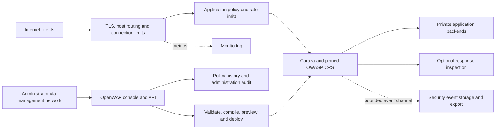

# OpenWAF: plan toward a dependable small-business WAF

Planning date: 2 November 2026. This document is a proposed product and engineering roadmap, not a claim that the capabilities below already exist. The current implementation is described in README.md and ARCHITECTURE.md. The project license remains a provisional choice pending the owner's decision.

First implementation update: schema-1 application identity, scoped query/body-field exceptions with expiry, durable policy revisions, comparison/rollback UI, single-writer leases and offline policy compilation are implemented. A separate Caddy compatibility lab now exercises 48 focused cases with identical CRS files. See [the security contract](docs/SECURITY_CONTRACT.md), [edge decision](docs/adr/0001-edge-connector.md), and [history decision](docs/adr/0002-policy-history.md). This is progress on M0/M1, not completion of the production gates. The next increment adds all 5,193 CRS cases with explicit platform expectations, process admission/buffer/connection limits, and bounded durable SQLite security events. See docs/REGRESSION-AND-OPERATING-LIMITS.md for raw differences and limitations. Focused HTTP/2, streaming, WebSocket, shutdown and process-crash recovery checks now pass on Windows and Linux. A bounded mixed-load probe records CPU, memory, rejection and event-loss evidence. See docs/PROTOCOL-AND-RECOVERY.md. Acknowledged group commits, counted overload summaries, a durable export outbox/reference collector and mixed-load/outage/restart soak tooling are now implemented; see docs/EVENT-DELIVERY.md for evidence and bounds. Verified offline recovery sets, coordinated sender/receiver checkpoint checks, guarded upgrade rehearsals and prepared rollback tooling are now implemented; see docs/BACKUP-RESTORE-UPGRADES.md. Multi-hour/days-long sizing, power-loss, live deployment and exhaustive protocol qualification remain open.

Health and monitoring update. Authenticated health and Prometheus endpoints now expose readiness, inspection mode, resource admission, write failures and export backlog using cached state. Collector/storage degradation stays visible independently of traffic readiness. See [monitoring](docs/MONITORING.md).

Appliance operations update. A Linux systemd package, file-backed credentials, validated certificate-file renewal with expiry warnings, and a separate bounded administration journal are implemented. The console exposes certificate reload/status and recent audit activity. Backup and candidate qualification preserve the journal. Certificate issuance uses an external provider, and audit archival is an explicit stopped-service procedure. Independent acknowledged audit export and byte-preserving offline replay are now implemented. Additional distribution/arm64 qualification, automated certificate issuance, sustained sizing and representative pilots remain M2/M4 work. [Linux operations](docs/LINUX-OPERATIONS.md), [Audit export](docs/AUDIT-EXPORT.md)

M4 application qualification update, 4 November 2026: the expanded isolated DVWA/WordPress/Keycloak suite passed 22 attack, benign-workflow, tuning, identity/lifecycle and monitoring cases. Real signing-key rotation, session expiry, account disable and provider outage/recovery passed. The bounded pilot collector and systemd templates are prepared. Actual pilot identity/TLS/factor recovery configuration, deployment-specific sizing, the reviewed 30-day business window and independent security review remain open. No business pilot has started. [Qualification](docs/M4-QUALIFICATION.md), [Pilot procedure](docs/PILOT.md)

## 1. Product outcome and starting assumptions

Local traffic and access update. Schema-2 applications now support bounded application/client token buckets, fixed concurrency/body-buffer shares and client concurrency caps. Durable local accounts provide administrator, operator and viewer roles with versioned session revocation and named audit actors. Roles default to deployment-wide access, explicit application assignments restrict operators/viewers, and the bootstrap token retains full recovery authority. Account-aware recovery and historical traffic-control capability checks are implemented. Scoped automation credentials and opt-in authenticator MFA are implemented. Configurable administrator MFA enforcement and account/token application assignments are implemented. External identity and sustained pilot qualification remain open. [Traffic and access contract](docs/TRAFFIC-AND-ACCESS.md)

Progress assessment on 4 November 2026 closes M3 for the scoped Linux amd64 profile. Business controls include bounded upstream pools, trusted-proxy identity, application/client rate and admission controls, accounts/RBAC, application assignments, scoped automation tokens, TOTP enforcement, passkeys, optional OIDC and pinned rule-update qualification. The completed build passed the full CRS corpus, permission/traffic/browser tests, the Linux race suite and native Ubuntu 24.04 two-hour sizing at 25 requests/second with three abrupt guest interruptions and actual r2/r6 upgrade/rollback. Ubuntu 22.04 covers functional compatibility. M4 now requires representative real applications and identity-provider/authenticator configurations, measured deployment capacity, the 30-day pilot and independent review. ARM64 remains experimental, and physical host/controller power loss remains outside the qualified guest profile. [M3 completion](docs/M3-COMPLETION.md), [M2 qualification](docs/M2-QUALIFICATION.md), [ARM64 criteria](docs/ARM64-QUALIFICATION.md)

Build a self-hosted application-security gateway that a small IT team can install, understand, tune, update, and recover. Its primary job is to reduce common application attacks while preserving legitimate business activity. An understandable event, a narrowly scoped exception, and a reliable rollback are core security features.

Initial customer model: a single organization, approximately 5–25 web applications or APIs, 1–5 administrators, a Linux VM or container deployment, and ordinary HTTP/HTTPS workloads. These are planning assumptions to validate with pilot users. Company size is not a capacity measurement; request size, concurrency, inspection settings, streaming, and backend behavior determine sizing.

Production target: Linux amd64 and arm64. Windows remains a supported development/demo environment until service installation, credential storage, filesystem behavior, and operational recovery have their own Windows qualification. A Kubernetes deployment is optional later.

Supported traffic must be documented explicitly: HTTP/1.1 and HTTP/2, HTML sites, REST/JSON, XML, URL-encoded forms, multipart uploads, and ordinary TLS termination. WebSocket handshake inspection and SSE passthrough must have explicit limits; WebSocket message inspection, semantic GraphQL protection, gRPC body inspection, and HTTP/3 are separate work.

The product cannot substitute for application authorization, secure application code, patching, database controls, endpoint protection, or upstream volumetric DDoS protection.

## 2. First action: establish a testable security contract

Write a short threat model and a supported-traffic contract before expanding features. Identify the public listener, backend network, administrator, external identity provider, certificate store, event store, update source, and optional threat feeds as distinct trust boundaries.

Record these invariants as executable tests:

1. Every supported protected request follows the policy selected for its listener/hostname; unknown hosts do not accidentally expose another application.
2. Rejected request bodies never reach the backend. Accepted bodies and request semantics are preserved.
3. The proxy, Coraza, and backend interpret framing and encoding consistently. Ambiguity is rejected rather than normalized independently by several layers.
4. Forwarded identity is accepted only from configured proxy networks. A client cannot set its own trusted identity headers.
5. A rejected or interrupted configuration update leaves a usable last-known-good policy. The UI distinguishes persisted, validated, deployed, and actually active revisions.
6. Loss of the control service, dashboard, event collector, or external feed cannot silently disable inspection.
7. Memory, body buffering, temporary files, inspection concurrency, queues, and disk use have enforced bounds.
8. Events identify the effective policy and rule versions, and sensitive data capture is deliberate and limited.
9. A restorable backup exists before migrations or upgrades; rollback is tested against the exact supported release path.

Then review the current connector and administration code against this contract. The recent 815-request exercise is useful, but its 25 attack samples do not establish a general detection rate. Investigate the shell-command sample that passed PL1: reproduce it, determine the relevant CRS rule/paranoia behavior, compare with a reference connector, and decide whether it is an upstream coverage issue or a justified application-specific policy. Do not add a sample-specific regex merely to improve the score.

## 3. Architecture decision: reuse a mature edge implementation

Keep Go, Coraza, and the real CRS. OpenWAF should own the application/policy model, configuration workflow, administration, evidence, and operating experience.

Evaluate Caddy with the maintained Coraza Caddy integration as the preferred edge foundation. Caddy provides existing TLS automation and reverse-proxy mechanisms; the Coraza module provides an existing integration path. Their suitability for our exact body handling, policy isolation, event access, reloads, and failure semantics must be tested. References: [Caddy reverse proxy](https://caddyserver.com/docs/caddyfile/directives/reverse_proxy), [automatic HTTPS](https://caddyserver.com/docs/automatic-https), [configuration API](https://caddyserver.com/docs/api), [Coraza Caddy module](https://github.com/corazawaf/coraza-caddy).

Time-box a comparison during the first milestone. Run the same protocol, body, CRS, cancellation, response, reload, and resource tests through the current connector and the candidate integration. Choose Caddy if it meets the contract and gives us a maintainable policy/event boundary. Otherwise retain the Go connector with a documented reason and an explicit connector test/maintenance commitment. This is one decision checkpoint, not two permanent production backends.

Target layout:

The inspection and proxy path is the data plane. Policy editing and administration are the control plane. Initially enforce clean module boundaries; before the business-ready release, use independently supervised processes so a dashboard failure does not stop traffic. Keep distribution simple: one installer or Compose bundle, with a small number of well-defined services. Do not introduce a microservice framework.

The data plane consumes immutable, versioned policy snapshots and retains the last-known-good snapshot. It should not synchronously query a configuration database, OIDC provider, or remote reputation service for each request. Any Caddy administration endpoint remains private to the controller, never exposed as an alternative public management API.

## 4. Integration policy

| Component | Proposed use | Boundary |
|---|---|---|
| OWASP Coraza | Primary inspection engine | Pin versions; upstream fixes where possible; no second handwritten engine |
| OWASP CRS and official application plugins | Generic protection and appropriate application tuning | Retain upstream files; generate local exceptions separately; review plugins individually |
| Caddy + Coraza connector | Preferred candidate for TLS, routing and edge behavior | Architecture gate before adoption; one supported edge implementation |
| SQLite | Initial policy/history/admin data and bounded local event indexes | Separate configuration and security-event workloads; local storage only; migrations and backup tests |
| Prometheus | Optional metrics integration | Bounded labels; no raw URL, IP, or user-value labels |
| Structured JSON/syslog export | Integration with existing logging/SIEM | Redaction, bounded queues, backpressure/drop counters, retry limits |
| OpenTelemetry | Optional later tracing | Follow HTTP conventions; sample and redact |
| OIDC using an established Go implementation | Later SSO and identity-provider MFA | Validate issuer/audience/nonce/state and sessions; preserve a controlled recovery account |
| Maintained local rate-limit implementation | Baseline application/route/IP limits | Cap key cardinality; distinguish trustable identities; test shared NAT behavior |
| Valkey or equivalent | Optional shared limits/state when multiple nodes require it | Not an installation dependency for the first single-node release; define outage semantics |
| CrowdSec | Optional later reputation/behavior adapter | Opt-in; bounded local cache, freshness/expiry, privacy, observable decisions and outages |

SQLite supports a simple embedded deployment, but its concurrency and WAL behavior need explicit evaluation. Do not place a shared SQLite WAL database on network storage for multiple WAF nodes. A future central control service may use PostgreSQL if measured needs justify it. Sources: [SQLite deployment guidance](https://www.sqlite.org/whentouse.html), [WAL](https://www.sqlite.org/wal.html).

External integrations must declare capabilities, timeout budgets, data shared, license, owner, version, and failure behavior. They must be optional unless fundamental to the supported architecture. Public feed outages must not turn inspection off.

## 5. Application and policy model

Replace the current single global policy with explicit objects:

- Listener: address, port, protocol/TLS settings, certificate binding, and management/public separation.
- Application: ID, name, allowed hostnames, listener bindings, path routing, owner and enabled status.
- Upstream pool: destinations, TLS verification/SNI, timeouts, health checks and load-balancing policy. Retry behavior must account for method safety and whether a request body can be replayed.
- Security policy: engine mode, CRS version, paranoia level, anomaly thresholds, request/response handling, upload budgets and route overrides.
- Rule exception: application, route/method/content-type scope, exact variable/parameter, rule ID, reason, owner, creation time, expiry and review status.
- Custom rule: supported structured actions plus an expert SecLang editor, namespaced IDs, test fixtures and version history.
- Rate policy: scope, keys, sustained rate, burst, duration, response, logging and node-local/distributed semantics.
- Deployment: draft/validated/staged/active/failed status, policy hash, node acknowledgments, actor, revision and rollback target.

Generate Coraza configuration from typed policy objects. The expert editor must not become an unrestricted path to filesystem directives or arbitrary runtime control. OpenWAF-generated conditional exclusions may use capabilities that are unavailable to arbitrary editor input; test the generated scope precisely.

Policy workflow: edit draft → validate → show human-readable diff and impact → replay approved fixtures/shadow evaluation → stage → activate → verify node revision → monitor → roll back if needed. A compiler success alone does not prove a safe policy. Shadow evaluation must be sampled and bounded; never replay production POSTs to a live backend to preview a policy.

## 6. False-positive management is the first major product feature

The initial tests show the tradeoff: PL1 allowed all 25 ordinary fixtures and blocked 24/25 attack fixtures; higher levels caught more but blocked increasing amounts of legitimate input. These figures apply only to that small corpus. PL4 must not be presented as a universal recommended setting.

Default new installations to a short, explicit detection/onboarding period, then offer a clear promotion to enforcement after owner review. The current enforcing default can remain for the isolated lab, but production onboarding must make its mode and consequences visible. Do not leave an installation in indefinite observation without reminders.

The event-to-exception workflow should show matched rule, variable, score contribution, application, effective revision, whether the request actually reached the backend, and safe redacted evidence. An administrator should be able to allow one legitimate field on one route while keeping the rule active elsewhere.

Example: accept formatted customer feedback in POST /feedback's `message` field, while keeping SQLi and unrelated XSS checks on the rest of the application. If the application accepts active JavaScript as content, that is a separate explicit trust decision. The WAF cannot determine whether arbitrary submitted code is safe for the application to execute or render.

Suggested exceptions require evidence, a reason, optional expiry, human acceptance, and a regression fixture. Repeated attacks are not evidence of legitimate behavior. Suggestions must never activate automatically. Source: [CRS false positives and tuning](https://coreruleset.org/docs/2-how-crs-works/2-3-false-positives-and-tuning/).

## 7. Dashboard designed around operating tasks

Use a typed frontend, preferably TypeScript + React + a small maintained accessible component library, with an explicit design system for tables, forms, status, navigation, errors and keyboard access. A build step is acceptable; the compiled assets remain embedded for distribution. Framework selection is a maintainability decision and must include a short dependency/license review. Preserve the existing visual direction while replacing fragile page-state logic incrementally.

Primary screens:

| Screen | Required task |
|---|---|
| Overview | Separate attacks, application errors, inspection failures, rate limits, uninspected traffic and service health |
| Applications | Configure hosts, upstreams, TLS, route overrides and meaningful health status |
| Policies | Compare drafts with deployed policy; inspect inheritance and node status |
| Security events | Filter and investigate an event; understand why and where it was stopped |
| Exceptions | Create a narrow exception; preview its scope; assign ownership and expiry |
| Rate limits | Configure bursts and keys; distinguish rate decisions from WAF rule decisions |
| Certificates | See provisioning, renewal failures, expiry and private-key storage status |
| Operations | Backups, restore, upgrades, rollback, disk/queue use and diagnostic export |
| Administration | Accounts, roles, sessions, tokens, SSO, API credentials and audit trail |

Every control must have a functioning backend, a documented scope, validation, persistence, an audit entry, and a test. Never label an unprobed backend healthy. Clearly distinguish configured, active and observed state. An event is not necessarily an attack, and an HTTP 403 is not necessarily a WAF decision.

## 8. Reliable operation and security of the WAF itself

Run as an unprivileged service with a read-only installation and narrowly writable data directories. Close direct public access to backend applications, or the WAF can simply be bypassed. Admin access uses a management network/VPN with HTTPS. Secure browser sessions, CSRF protection, role checks, OIDC support and credential rotation are part of the product, not an external assumption.

Start with administrator, policy editor and read-only roles. Separate short-lived browser sessions from revocable, scoped API tokens. Bootstrap credentials should be one-time where possible; avoid routinely printing a persistent administrative secret. Keep a documented local recovery process with its own audit record. Credentials and certificate private keys require real filesystem permissions; do not put the encryption key next to encrypted data and call that protection.

Enforce route/body limits and a total buffering/concurrency budget. One hundred concurrent 10 MiB request buffers already consume about 1 GiB before overhead or any second copy. Use appropriately bounded memory/disk spooling, cancellation, cleanup and overload rejection. Establish separate budgets for request inspection, response inspection, event writing and policy compilation.

Response inspection needs an explicit compatibility matrix: MIME eligibility, compression/decompression and expansion limits, response length/integrity headers, HEAD, 204/304, upgrades, ranges, streaming and cancellation. Record skipped inspection reasons. Apply business-appropriate behavior by route; a payment API and an SSE endpoint need different policies.

Make failure behavior explicit:

| Failure | Required behavior |
|---|---|
| Invalid new policy | Retain active revision and report the error |
| Control process stopped | Data plane continues with last-known-good policy |
| Corrupt/missing policy on fresh boot | Stay unready; do not silently start an unprotected proxy |
| Backend unavailable | Bounded timeout and clear gateway error; no unsafe blanket retries |
| Inspection failure or overload | Reject according to the documented policy; no hidden bypass |
| Event disk full | Enforce retention/quotas, raise alarms, apply documented event loss/backpressure behavior |
| Threat feed unavailable | Continue core inspection; use only defined unexpired cached decisions |
| Certificate renewal failure | Alert in advance; retain valid certificate; never silently downgrade to plain HTTP |
| Rate-state store unavailable | Use the explicit local fallback or reject policy selected for that application |

Separate a durable administration audit from the high-volume security event stream. Store event metadata by default; redact authentication headers, cookies, tokens and sensitive values. Bound and time-limit any diagnostic payload capture. Support retention by both age and bytes. An attacker must not fill the disk merely by generating logs. A local audit log is not tamper-proof against a compromised host; offer forwarding to an independent collector.

## 9. Test and release strategy

Use a layered test program with saved results:

1. Deterministic unit and integration tests for policy compilation, activation, exception scope, identity, body handling, tokens, sessions and storage migrations.
2. Real-listener tests for HTTP framing, duplicate headers, lengths/transfer encoding, malformed multipart/JSON/XML, encoded inputs, content encodings, chunked traffic and disconnects. Test HTTP/2 conversions and supported upgrade/streaming paths.
3. The full applicable upstream CRS regression corpus through go-ftw against the actual OpenWAF connector. Pin corpus and engine versions together; document skips/expected differences. Coraza unit tests passing is not enough.
4. Differential tests against an established Coraza connector and, where useful, ModSecurity/CRS. Investigate semantic differences; another engine's verdict is evidence, not an automatic oracle.
5. A labeled benign corpus built from sanitized real application workflows. Synthetic examples complement it. Track request-level false blocks, rule-specific false alerts, endpoint/workflow coverage and customer impact separately.
6. Fuzzing, Linux race-detector runs, security/dependency scans, management API security tests and browser/accessibility tests.
7. Fault injection: full disk, slow disk, event collector outage, expired certificates, denied backend TLS, dead upstream, process kills, interrupted migrations, lost control link, corrupt config and failed rollback.
8. Performance tests against a no-WAF baseline, with hardware, Go version, CRS version, response sizes, TLS, paranoia and concurrency disclosed. Measure latency added by inspection, sustainable throughput, CPU, peak memory, temporary storage, queue depth and overload behavior. Run attack-heavy and large-upload workloads separately.

Candidate capacity target for sizing work: qualify a named 4-vCPU/8-GiB Linux reference host at around 1,000 requests/second for a documented small-body PL1 workload, with added p95 latency initially targeted below 10 ms. These are proposed engineering targets to confirm after baseline measurement, not a present product claim. Independently characterize uploads, response inspection, long-lived connections and attack-heavy traffic. Do not derive capacity from the 500-request smoke check.

For a pilot, start with representative apps and low-risk traffic in detection mode, review exceptions, enable enforcement in stages, and exercise rollback. A proposed gate is 30 consecutive days of pilot operation without unexplained traffic loss, plus a successful backup restore and upgrade/rollback drill. Security events require review throughout that period; elapsed time alone is not a pass.

Sources: [go-ftw](https://github.com/coreruleset/go-ftw), [Go fuzzing](https://go.dev/doc/security/fuzz/), [Go vulnerability management](https://go.dev/doc/security/vuln/), [OWASP ASVS](https://asvs.owasp.org/), [ZAP API scans](https://www.zaproxy.org/docs/docker/api-scan/). HTTP interpretation follows the relevant [HTTP semantics](https://www.rfc-editor.org/rfc/rfc9110), [HTTP/1.1](https://www.rfc-editor.org/rfc/rfc9112), and [HTTP/2](https://www.rfc-editor.org/rfc/rfc9113) standards, including current updates and errata.

## 10. Milestones with exit criteria

Effort estimates assume one or two experienced maintainers and access to independent review. They are planning ranges, not delivery promises. Milestones can overlap, but acceptance gates cannot be skipped.

| Milestone | Indicative effort | Main deliverables | Exit criterion |
|---|---|---|---|
| M0: security contract | 1–2 weeks | Threat model, supported traffic, honest feature matrix, edge comparison, reference corpus | Architecture decision recorded; connector invariants and reproducible failures captured |
| M1: dependable policy | 3–5 weeks | Application model, durable revisions, exact exception scopes, draft/activate/rollback, deployment acknowledgment | A narrow exception fixes its legitimate fixture without weakening other routes; failed updates preserve service |
| M2: operable Linux amd64 appliance | 4–6 weeks | Durable bounded events/admin audit, backup/restore, amd64 Linux deployment, health/metrics, certificate lifecycle, frontend workflows | An operator can install, diagnose, restore and upgrade using the documented procedure, with measured process-level sizing and abrupt-VM-interruption evidence |
| M3: business controls | 4–8 weeks | Multiple applications/upstreams, trusted-proxy identity, scoped rate limits, accounts/RBAC, SSO option, API tokens, rule-update pipeline | App isolation and permission tests pass; representative workflows work under enforcement. Closed for the scoped Linux amd64 profile on 4 November 2026. [Evidence](docs/M3-COMPLETION.md) |
| M4: qualified pilot | 6–10 weeks | Full applicable regressions, fault/resource tests, documented performance, pilot tuning and independent review | Pilot exit criteria met; relevant release-blocking security/reliability findings resolved |
| M5: business-ready 1.0 | Gate-based | Reproducible signed builds, support policy, recovery documentation, tested upgrades and published limitations | All readiness criteria below have recorded evidence |

A sensible expectation for a dependable first business release is roughly 6–12 months of sustained work and real pilot feedback, depending on staffing and defects found. A controlled pilot may be possible earlier after M1/M2, if its risk and scope are acceptable. AI-assisted coding speeds implementation; protocol validation, operational observation and independent review still determine the schedule.

## 10.1 M4 execution and evidence gates

The following is the ordered M4 queue. It expands the existing qualification milestone; feature count does not close these gates.

Capacity update on 4 November 2026: the first native colocated one-vCPU reference profile passed five-request/second five/ten-minute schedules and separate large-body, admission, backend-fault and receiver-outage checks. All 5,342 gateway requests and 1,246 records / 1,289 occurrences reconciled, including independent verification of captured databases. Ten and 25 requests/second encountered configured admission refusals. Subsequent profiling identifies regex CPU cost and a conservative downstream optimization with a 6.4x reduction in the targeted 900-KiB sample. CPU-heavy competition includes an intentionally expensive Unicode fallback and a tested one-slot admission policy; hard CPU isolation is not established. The next gates are independent patch review and qualification against the selected deployment's workload, body/admission limits and headroom budgets. [CPU evidence and limits](docs/M4-CPU-QUALIFICATION.md), [capacity results](docs/M4-CAPACITY-RESULTS.md), [findings](docs/M4-FINDINGS.md)

1. **Representative applications:** retain pinned DVWA direct-exploit/WAF-block pairs, WordPress benign workflows and narrow tuning with paired negative checks. The owner selected PrestaShop and Dolibarr first, then ERPNext for stack diversity. Nineteen Dolibarr and eight PrestaShop cases now pass on the Host-preservation candidate, including native CSV import/multipart, contacts/validated orders, reader/CSRF controls, cart removal/re-addition and committed checkout state. Wider roles/CSRF, native export, storefront/back-office workflows and the actual pilot workload remain open. [Application matrix](docs/M4-BUSINESS-APPLICATIONS.md), [exact-build evidence](docs/M4-BUSINESS-RESULTS.md)
2. **Identity lifecycle and failure:** exercise real Keycloak signing-key rotation with changed signing key IDs, provider outage/recovery, bounded session expiry, disabled provider/local accounts, local session revocation and administrator recovery. Core rotation/expiry/disable/outage checks passed in the isolated lab. The pilot's actual TLS/client configuration and administrator factor recovery remain open. Record existing-session behavior explicitly. Keep synthetic malformed-token/issuer/audience/nonce regressions alongside real-provider evidence. Tests must restore changed provider settings and preserve failed reports.
3. **Deployment capacity:** measure mixed benign/attack traffic, representative bodies/uploads, concurrency, slow backends, overload fairness and event/export health. Include CPU-heavy competition and conservative-optimization fallback inputs. Review the downstream Coraza patch independently and keep its provenance/update discipline explicit. Publish hardware, policy, workload, latency distribution, CPU/RSS, rejection/error rates and event reconciliation. Identify a supported operating envelope with headroom; gateway-only M3 figures do not size colocated applications. Select smaller body/admission limits or separate CPU/process allocations when abuse requirements demand them, then run deployment endurance.

   The first actual business profiles now pass separately at five requests/second
   for ten minutes each on the one-vCPU/4-GiB VM. All 6,960 protected requests
   reconcile, with zero unexpected verdicts/network/generator errors or event
   loss/pending delivery. Dolibarr includes real edits/uploads; PrestaShop covers
   storefront reads. Native sampling uses guest monotonic brackets; CPU gating
   takes the higher guest-busy/component reading because virtualized counters
   disagree. The newer boundary/replay candidate additionally passes near-limit
   native/API uploads, 32-client bursts and joint ERP/storefront admission tests.
   Its 700-KiB-upload profile now passes for thirty minutes at 0.25 ERP +
   1 storefront request/second: all 2,250 endurance requests and all six
   five-minute windows pass; the full 2,888-request suite reconciles. Wide
   admission of large Unicode probes causes eight client timeouts and remains
   failed. Separate one-slot/body/rate screens reconcile 1,364 requests and
   911 security occurrences. One slot preserves storefront latency but
   saturates CPU; the stricter 64-KiB/one-request-per-second profile rejects
   larger legitimate uploads. Longer hostile-load endurance, reverse/joint
   attacks, authenticated commerce writes, customer host/workload accounting
   and final-package operational repetition remain open.
   [Extended evidence and limits](docs/M4-JOINT-ENDURANCE-ABUSE.md),
   [earlier single-product profiles](docs/M4-BUSINESS-CAPACITY.md)
   **6 November abuse gate:** retained ten-minute reverse-abuse failures show
   legitimate 503s despite acceptable aggregate p95. Opt-in bounded admission
   waiting is implemented on a distinct candidate; one- and two-vCPU varied-CSV
   screens still fail, and a two-vCPU admitted probe has an upstream EOF. Require
   zero legitimate refusals, exact 700-KiB round trips, per-phase/window latency,
   source identity and durable-event accounting. Qualify hardware/concurrency
   changes separately; keep the multi-address exhaustion boundary explicit.
   [Sustained fairness evidence](docs/M4-SUSTAINED-FAIRNESS.md)
   Follow-up finds and regression-fixes partial writes on idle reused upstream
   sockets and stale exporter health after a verified checkpoint commits late.
   Four-slot/two-client concurrency still fails simultaneous-abuse latency.
   The per-client outstanding buffer budget now passes the four-vCPU/4-GiB
   thirty-minute directional/simultaneous schedule with 93 successful file
   workflows and all six windows within budget. All 6,640 security occurrences
   independently reconcile. The two-peer held-request case exhausts application
   slots and records two legitimate 503s with full reclamation. Full browser/
   shared-NAT load and the actual host/workload remain deployment gates. The
   [browser/NAT harness](docs/M4-BROWSER-NAT.md) compares full asset bursts,
   four authenticated users and parallel large-file API workflows using
   separate peers and one shared TCP peer. Higher NAT-oriented limits require
   fresh abuse qualification before adoption. The full-browser reference
   exposes and regression-fixes a completed-body deadline leaking into slow
   upstream handling. Candidate `20031ed996b3` passes both full platform suites
   and all 5,193 CRS cases each, plus focused Linux race checks. The strict
   API-abuse limits reject normal browser asset bursts even with separate
   addresses. The reference and four-wave higher-limit NAT screen now pass,
   with 1,201 requests, seventeen files and 339 occurrences independently
   verified. Twelve false claims are rejected. Shared-source browser/abuse
   endurance on those higher limits remains open. Keep the workload envelopes
   distinct. Follow-up abuse testing rejects the initial higher-limit profile
   and the two-core service-quota experiment. Optional body-byte admission
   budgets now preserve asset request-rate headroom while bounding large-body
   volume, with both full platform/CRS pipelines, race and console checks.
   Individual ERP/storefront abuse screens pass; combined and same-source
   pressure require further qualification. Ambiguous upstream mutation failures
   now receive native file reconciliation in the harness.
   [NAT abuse and endurance](docs/M4-NAT-ABUSE.md),
   [body-byte controls](docs/CLIENT-BODY-RATE.md). One
   boundary boot stall is retained with its successful same-allocation retry.
   [Client buffer sizing](docs/CLIENT-BUFFER-BUDGET.md),
   [idle-reuse trace](docs/M4-UPSTREAM-IDLE.md),
   [export health](docs/M4-EXPORT-HEALTH-RECOVERY.md)

4. **Pilot entry and operational rehearsal:** choose a continuously available host, application owner, daily reviewer and alert recipient; verify TLS, backend bypass prevention, least-privilege monitoring, credential renewal, privacy/retention, alerts, backup restore and the deployed-artifact upgrade/rollback pair. Confirm rollback triggers and incident ownership before starting the clock.

   The corrected candidate's actual M3-r7 upgrade/rollback, three guest interruptions and replacement-directory restore with copied TLS/authentication assets now pass. The current candidate additionally passes restoration into a separate clean Ubuntu 24.04 amd64 OS with WAF/receiver state, factors, verified TLS traffic and controlled backends. Business-database recovery and the actual pilot's deployed alert/recovery configuration remain open. [Scoped recovery evidence](docs/M4-RECOVERY-REHEARSAL.md), [fresh-host drill](docs/M4-FRESH-HOST-RECOVERY.md)

   The newer Host-preservation candidate also passes its actual previous-candidate
   upgrade/rollback, three interrupted writes, same-VM replacement and a 30-minute
   WordPress/DVWA reference phase. Its verified-TLS H1/H2/resumption repeat and
   fresh 22-case application/Keycloak suite now pass too. Business capacity,
   customer configuration/factor recovery, business-database recovery, alerts and the
   actual pilot remain open. [Current candidate ledger](docs/M4-CURRENT-CANDIDATE.md)

   Deployed alert qualification now passes 14 systemd-service cases with 12
   acknowledged failure/recovery transitions. Invalid certificate reload,
   unresponsive event/audit receivers, real ENOSPC in an isolated 16-MiB filesystem,
   unreadable evidence and an actual 182-second sampling pause are detected.
   Exact-ID webhook acknowledgement, restart/retry and receiver deduplication
   pass. One deliberately unacknowledged full-disk event write is explicitly
   counted; committed records reconcile. The actual recipient notification,
   timer scheduling and independent watchdog supervision remain deployment
   gates. [Alert transport, evidence and limits](docs/PILOT-ALERTS.md)
5. **30 consecutive reviewed days:** collect bounded health/canary evidence and daily workflow/security-event reviews, investigate false blocks and unexplained passes, retain failures and restart the qualifying interval after blocking failures or coverage gaps. A synthetic month or short lab run does not satisfy elapsed observation.
6. **Independent review and M4 exit:** obtain independent review of protocol/connector behavior, management authorization, identity/session handling, policy generation, secret storage and upgrade/recovery. Resolve release-blocking findings, record accepted residual limitations and review all evidence with the operator before declaring M4 complete. M5 release signing, provenance and support ownership remain separate gates.

CPU follow-up completed for the local reference: the corrected package passes
full Windows/Linux CRS and all 22 application cases. Native original/corrected
competition verifies heavy payload integrity and independent event delivery;
deadline exhaustion no longer poisons backend health. A first optimized-engine
five/ten-minute reference passes with its distinct binary identity retained.
The next capacity gate is the chosen deployment's actual workload, body/admission
and headroom budgets plus endurance; independent patch review and the business
pilot remain open. Preserve free-space headroom and measurement-source snapshots
when repeating qualification. [Detailed evidence](docs/M4-CPU-QUALIFICATION.md)

Corrected-build endurance/transport follow-up: a 30-minute five-request/second
combined application phase passes with 190-ms p95, after baseline, five-minute
steady and fault checks. All 11,342 frontend requests and 2,746 records / 2,789
occurrences reconcile. Separate verified-TLS fresh/persistent HTTP/1.1 and HTTP/2
workloads pass, including multiplexing, resumption, body integrity and authority
isolation, with all 1,846 requests independently accounted. Sustained resource
budgets and complete monitoring coverage are now explicit gates. The initial
invalid test-CA fixture remains failed and retained. This closes the local
corrected-binary endurance/transport slice, not deployment sizing, independent
review or the 30-day pilot. [Evidence and limits](docs/M4-ENDURANCE-TRANSPORTS.md)

Current evidence and remaining work: [M4 qualification](docs/M4-QUALIFICATION.md). Measurement protocol: [Capacity qualification](docs/CAPACITY-QUALIFICATION.md). Retained limits and required follow-up: [M4 findings](docs/M4-FINDINGS.md), [capacity evidence](docs/M4-CAPACITY-RESULTS.md), [CPU study](docs/M4-CPU-QUALIFICATION.md). Targeted profiling and CPU-heavy competition are measured; the actual shared-host pilot profile still needs workload/headroom acceptance and endurance. Observation procedure: [Pilot](docs/PILOT.md). No business pilot has started.

## 11. First two-week work queue (historical starting plan)

1. Record target deployment, supported protocols, threat model, fail behavior, and performance measurement plan.
2. Turn the existing test corpus and findings into permanent regression fixtures; investigate the PL1 shell-command coverage observation.
3. Integrate a pinned go-ftw job against real listeners and publish initial pass/skip/failure accounting.
4. Run the Caddy/connector comparison and write an architecture decision with evidence.
5. Design a versioned policy schema for applications, routes, exceptions and revisions, with sample migrations and round-trip tests.
6. Implement the first application/path/parameter-scoped exception workflow, with paired allowed/blocked regression cases.
7. Specify durable policy history and activation/rollback acknowledgment before adding more console controls.
8. Prototype resource budgets and report memory behavior under concurrent large requests; capture the work required to avoid duplicate buffering.

Items 1–4 precede committing to a new edge implementation. Items 5–8 may extend into M1; they are an ordered queue, not an assertion that all fit into ten working days.

## 12. Longer-term product development

After M4 qualification, prioritize the policy testing and review workflow: explain
the triggering evidence, preview the exact policy change, replay approved benign
workflows and paired attack cases, expose untested scope, and retain approval,
ownership and rollback evidence. Evaluate success through operator accuracy and
time to a safely reviewed change.

Optional LLM assistance remains a deferred research direction, not a committed
feature or M4 exit requirement. Preserve complete core WAF operation without a
model, cloud service or GPU. Evaluate permission-scoped local retrieval of reviewed
cases before training model weights. Raw traffic and model-generated labels are
not automatically trusted training data. Any later fine-tuning proposal needs
explicit customer opt-in, data minimization, provenance, separate customer/access
boundaries, held-out and adversarial evaluation, versioned offline training and
reviewed promotion/rollback. Continuous collection of approved feedback does not
authorize continuous production weight updates or autonomous policy activation.

After the initial pilot, add API endpoint/method/content-type controls and optional bounded OpenAPI schema validation in observation-first mode. Schemas do not establish authorization. Build basic anti-automation from trusted rate/behavior signals, expiring server-verified challenges, and explicit exemptions for APIs, webhooks and accessibility needs. Do not use a client-side delay or a token handed out with the challenge as proof of human verification.

Later add optional CrowdSec integration, application-specific CRS plugins, mTLS upstreams, certificate integrations, and migration/export tools. Revisit distributed rate-state only when a second traffic node requires it.

For availability, prefer independently running traffic nodes behind an existing load balancer, with centralized desired policy and visible per-node applied revisions. Test node failure and restoration. Keep local data-plane operation possible during controller loss. Do not describe replication of a SQLite file as high availability. Shared counters, certificate renewal ownership, event export and consistent policy rollout need independent designs.

At a later maturity stage, offer controlled canaries, policy promotion between staging and production, optional central administration, and a supported release line. Advanced bot scoring, richer API discovery, custom plugin execution, HTTP/3, and payload inspection for new protocols each require a fresh threat model and maintenance owner.

Avoid adding a second WAF engine, opaque ML blocking, a mandatory external reputation service, arbitrary third-party code plugins, or automatic exception activation just to grow the feature list. Add capabilities when a measured customer need and a testable contract justify them.

## 13. Open-source maintenance and release ownership

Initialize a clean source repository when the owner chooses the publishing location; omit local credentials, archives and cloned reference repositories. Resolve the license choice before public release. Preserve all applicable upstream licenses and notices regardless of the license chosen for original OpenWAF code.

Add CONTRIBUTING, SECURITY, support scope, maintainer roles, issue templates, versioning/migration policy and a coordinated vulnerability-disclosure process. Keep design decisions and known limitations in the repository. Review dependencies for maintenance, license, data exposure and practical removal/migration paths.

Pin runtime, rule and build dependencies. Each update proposal runs compatibility, attack, benign-traffic and policy-migration tests; summarize verdict changes before promotion. Maintain rollback artifacts and offline-install options. Produce checksums, an SBOM and signed release artifacts with provenance. Define which components and operating systems receive security fixes and for how long; do not promise an SLA without staffing it.

Responsibility must include product/operator decisions, engineering review, security validation, deployment testing, documentation and pilot feedback. Before a business-ready claim, budget independent review of the connector, management authorization, rule generation, secret handling and update path. Automated assistance does not replace accountable maintainers.

## 14. Business-ready release checklist

- Documented supported traffic and installation topology, including preventing direct backend bypass.
- Correct and isolated application selection, identity handling, inspection and upstream behavior.
- Narrow exceptions, policy diff/history, safe activation and tested rollback.
- Maintained generic rules and a repeatable upgrade-qualification process.
- Persistent bounded security evidence and an administration audit, with privacy controls and independent export.
- Expiring sessions, usable bootstrap/recovery, authorization, RBAC and revocable automation credentials.
- Reliable certificate lifecycle and externally visible expiry/failure alerts.
- Resource and overload limits verified under adverse traffic; performance envelopes published without exaggeration.
- Recovery demonstrated from backup; control-service loss and traffic-node failure behavior exercised.
- Representative application pilot results and full applicable regression accounting.
- No unresolved release-blocking security findings; other known limitations documented and explicitly accepted.
- Signed, reproducible release artifacts, dependency inventory, support ownership and disclosure process.

## 15. Source and reference policy

Use upstream documentation/source and standards as the first authority. Verify versions and support status when selecting a dependency. Vendor interface screenshots can inform navigation, but are not evidence of detection quality or permission to copy branding or code.

| Reference | What to learn/use |
|---|---|
| [OWASP Coraza](https://coraza.io/docs/) | Engine lifecycle, supported directives, body processing, operators and transformations |
| [OWASP CRS](https://coreruleset.org/docs/) | Generic rules, scoring, paranoia, tuning, plugins and regression expectations |
| [Coraza Caddy connector](https://github.com/corazawaf/coraza-caddy) | Integration behavior, tests and edge compatibility |
| [Caddy](https://caddyserver.com/docs/) | TLS automation, reverse proxy, health checks, reload and operational design |
| [OWASP ModSecurity](https://github.com/owasp-modsecurity/ModSecurity) | SecLang semantics, audit behavior and differential reference cases |
| [NAXSI](https://github.com/nbs-system/naxsi) | Scoped tuning/learning concepts; verify maintained forks before any dependency decision |
| [BunkerWeb](https://github.com/bunkerity/bunkerweb) | Deployment, onboarding and administration ideas; independently review licensing before reusing code |
| [go-ftw](https://github.com/coreruleset/go-ftw) | WAF regression execution and expected-result discipline |
| [OWASP ASVS](https://asvs.owasp.org/) | Security requirements for OpenWAF's own console and API |
| [HTTP RFCs](https://www.rfc-editor.org/rfc/rfc9110) | Protocol semantics and parsing boundaries, including current updates |
| [SQLite](https://www.sqlite.org/whentouse.html) | Embedded storage limits, transactional behavior and recovery |
| [Prometheus](https://prometheus.io/docs/practices/instrumentation/) / [OpenTelemetry](https://opentelemetry.io/docs/specs/semconv/http/) | Metrics design and interoperable telemetry |
| [CrowdSec](https://docs.crowdsec.net/docs/intro/) | Optional behavior/reputation integration and its decision lifecycle |
| [OpenAPI](https://www.openapis.org/) / [ZAP](https://www.zaproxy.org/docs/docker/api-scan/) | API contract tooling and authorized local/staging security tests |
| [Go security tooling](https://go.dev/doc/security/vuln/) | Fuzzing, vulnerability checks and supported runtime updates |

The existing clones are reading material. Importing a directory, claiming a lineage, or copying a UI does not constitute a validated integration. Every adopted capability must have its own accountable implementation, operational behavior and tests.

The prior Windows PL1 shell-command miss is resolved by the upstream engine pin containing the path-normalization fix; the Caddy comparison now requires 403 at PL1 too. No sample-specific rule was added.

